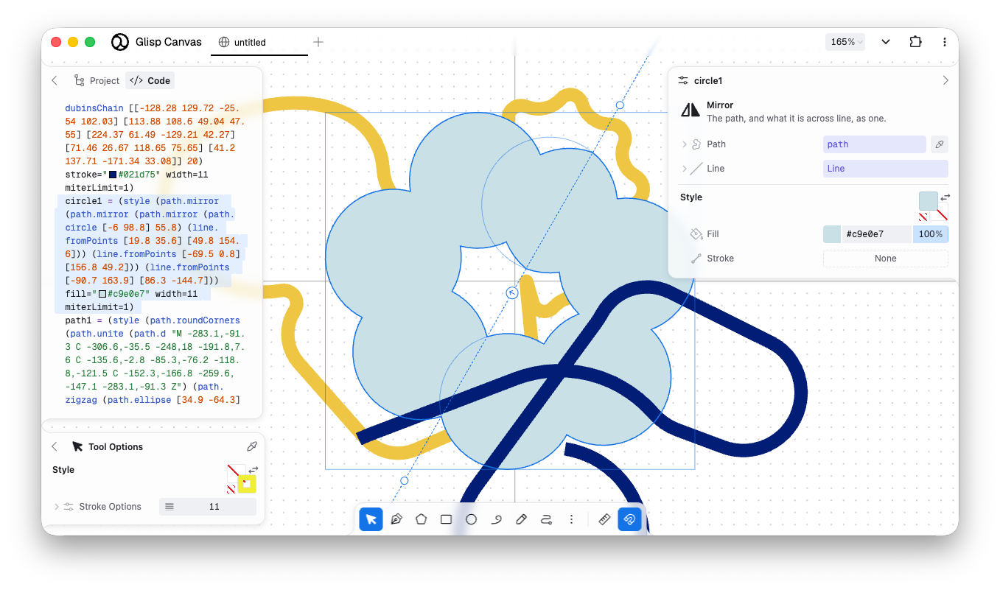

# Glisp

A small functional language for embedding in creative software, and a vector drawing app built on it. A program can be edited as text, as blocks, or by dragging what it draws on a canvas.

This is a work in progress, and the language may still change.



## Example

```clojure
{
  turn = (/ tau 96)
  ring = (map (range 0 96) (=> (i: number): _
    [(+ 400 (* 290 (cos (* i turn))))
     (+ 400 (* 290 (sin (* i turn))))]))
  [
    dots = (spray ring 7 3 26 44 "#ff4d2e" "#ffd23f")
    rays = (style
      (path.radial [400 400]
        (map (range 0 24) (=> (i: number): _ [(* i 15) 70 215])))
      stroke="#ffffff" width=3)
    bg = (background "#1473e6")
  ]
}
```

## About

Glisp stands for Graphical LISP. A project in the drawing app is a Glisp program: dragging a handle on the canvas rewrites a value in the program, and the program can be edited as code at any time. The app is not aimed at one kind of graphics.

In the language:

- Evaluation does not change the AST or any environment. An effect is an `IO` value that the host runs.
- There is no clock or built-in source of entropy. `random` makes a sequence from a seed, which is part of the program.
- An error in a program gives `()` and a diagnostic, rather than throwing. A typed slot turns `()` into its type's default.
- Types are sets of values, with structural subtyping.
- Results are cached on what a node refers to, so a value that an edit did not affect stays `===`.
- `solve` works out what to write in the program for a value to come out as wanted, which is how dragging works.
- `@glisp/lang` has no dependencies.

See the [guide](site/lang/guide.md) and the [specification](spec/README.md).

## Development

```sh
git clone --recurse-submodules https://github.com/baku89/glisp
cd glisp
npm install

npm run dev:canvas   # the drawing app
npm run dev          # the website, with the guide and the playground
npm run repl         # a REPL in the terminal
npm test
npm run typecheck
```

| Directory | |
|---|---|
| [`packages/lang`](packages/lang) | The language, `@glisp/lang` |
| [`packages/repl`](packages/repl) | The terminal REPL |
| [`packages/tweeq`](packages/tweeq) | Editing an AST through [Tweeq](https://github.com/baku89/tweeq) widgets |
| [`site/canvas`](site/canvas) | The drawing app |
| [`site/lang`](site/lang) | The website |
| [`spec`](spec) | The specification, whose marked examples run as tests |

The drawing app uses [pave](https://github.com/baku89/pave) for paths, [geome](https://github.com/baku89/geome) for geometry, and [linearly](https://github.com/baku89/linearly) for vectors.

## Not done yet

- Tools that can be written by the user
- A timeline, and video export
- Raster images and GLSL filters
- Binding controllers over OSC or MIDI

## Earlier version

The first version, from 2020, was a design tool with an interpreter based on [Make a Lisp](https://github.com/kanaka/mal). It is [still online](https://glisp.app/commit:e7fbaae/). This repository has since been rewritten.

## Related projects

- Para and [Dynamic Brush](https://jenniferjacobs.mat.ucsb.edu/#db) by Jennifer Jacobs
- [Sketch-n-Sketch](https://ravichugh.github.io/sketch-n-sketch/)
- [Ronin](https://100r.co/site/ronin.html) by Hundred Rabbits
- [Quil](http://www.quil.info/)
- [snek](https://github.com/inconvergent/snek) by Anders Hoff
- Autoshop and Auto-Illustrator by Adrian Ward
- [Scriptographer](https://scriptographer.org/) and [Paper.js](http://paperjs.org/) by Jürg Lehni

## Credits

By [Baku Hashimoto](https://baku89.com). Thanks to [Naoto Hieda](https://naotohieda.com/) for examples, suggestions and translation, and to the [sponsors](https://github.com/sponsors/baku89).

MIT License. See [LICENSE](LICENSE).
