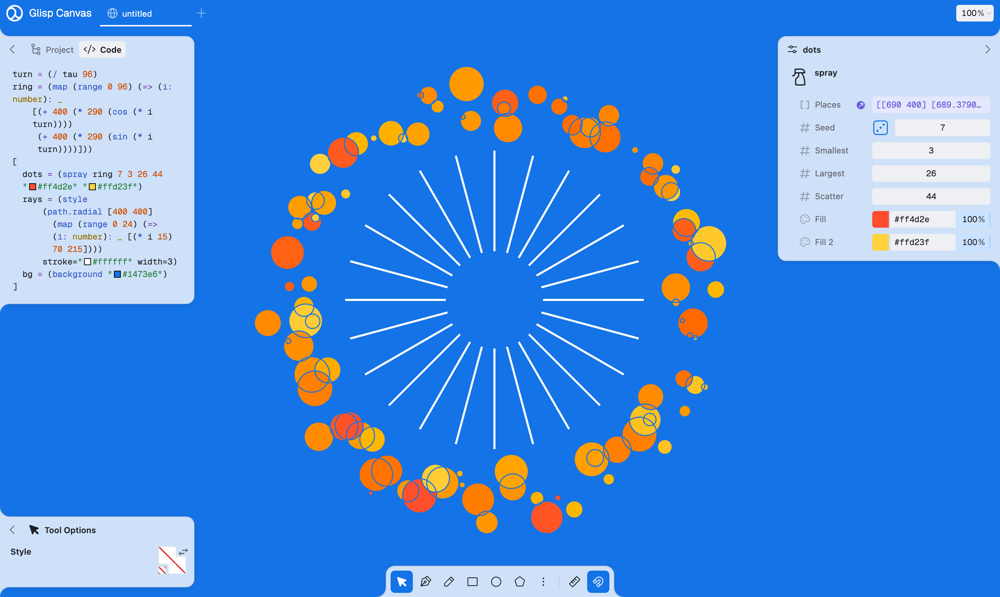

<div align="center">
  

  <h1>Glisp</h1>

  <p><strong>A language made to be drawn with.</strong><br />
  The same program is edited as code, as blocks, and by hand on a canvas.</p>

  
</div>

## Why

Glisp, for **G**raphical **LISP**, asks what happens when a design tool meets creative coding, and neither gives way.

Most design tools are tuned for one kind of work, and most programming environments stop at the code. Here, the file you are drawing in *is* a program: a tree of shapes you can drag on a canvas, and an expression you can abstract, reuse and rewrite. Dragging a dot edits a number. Writing a function gives you a new kind of dot. What the tool is for is left up to you: graphic design, illustration, generative art, or something it was never thought of for. I call that being **purpose-agnostic**, and I believe a tool gets stronger for not deciding how it should be used.

## What it looks like

This is the program in the picture above, all of it.

```clojure
{
  turn = (/ tau 96)
  ring = (map (range 0 96) (=> (i: number): _
    [(+ 400 (* 290 (cos (* i turn))))
     (+ 400 (* 290 (sin (* i turn))))]))
  [
    dots = (spray ring 7 3 26 44 "#ff4d2e" "#ffd23f")
    rays = (style
      (path.radial [400 400]
        (map (range 0 24) (=> (i: number): _ [(* i 15) 70 215])))
      stroke="#ffffff" width=3)
    bg = (background "#1473e6")
  ]
}
```

A let-block is only a graph of what refers to what, so the order of its names means nothing. The vector is what gets drawn, first in front. Press the die next to `Seed` and the `7` in the program changes, and with it, every dot.

## What it is made of

- **One program, three ways to touch it.** Every form has to work in code, in blocks and by direct manipulation, so the syntax stays small. Reserved words are symbols, such as `=>`, `?`, `|>` and `:`.
- **Dragging works backward.** A handle on the canvas asks `solve` what the program would have to say for the value to be there, and edits that.
- **Evaluation changes nothing.** Not the program, and not any environment. Editing means making a new AST, and an effect is a value that a host chooses to run.
- **The same, every time, on any machine.** There is no clock and no `Math.random`. Randomness is `random`, from a seed written in the program.
- **There is always something to draw.** A mistake in a program gives `()` and a diagnostic, never an exception, and a typed slot turns `()` into its type's default.
- **Types are sets of values**, with structural subtyping. `_` means "not known", and fits anywhere.
- **Only what changed is worked out again.** Results are cached on what a node refers to, not on where it is, so values that did not change stay `===` across edits.
- **Functions unfold.** A function's body is its next rung on the abstraction ladder, and you can step down it to see what something is made of.

## Try it

```sh
git clone --recurse-submodules https://github.com/baku89/glisp
cd glisp
npm install

npm run dev:canvas   # Glisp Canvas, the drawing app
npm run dev          # the website, with the guide and the playground
npm run repl         # the language, in a terminal
npm test
```

Read the [guide](site/lang/guide.md) to learn the language, or the [specification](spec/README.md) for the details.

## What's in here

| | |
|---|---|
| [`packages/lang`](packages/lang) | The language, `@glisp/lang`. No dependencies, to embed anywhere. |
| [`packages/repl`](packages/repl) | The terminal REPL. |
| [`packages/tweeq`](packages/tweeq) | Edit an AST directly through [Tweeq](https://github.com/baku89/tweeq) widgets. |
| [`site/canvas`](site/canvas) | Glisp Canvas, the drawing app, which is the point of all this. |
| [`site/lang`](site/lang) | The language's website: the guide and the playground. |
| [`spec`](spec) | The specification, of which the marked examples run as tests. |

Paths come from [pave](https://github.com/baku89/pave), geometry from [geome](https://github.com/baku89/geome), and vectors from [linearly](https://github.com/baku89/linearly).

## Where it's going

Fantasized since the first version, and still being worked through:

- [x] Evaluating only what changed, rather than the whole project on every tweak
- [x] Referring to another node by a relative path, like Houdini's `ch("../transform/tx")`
- [x] A list of layers, and selecting by clicking on the canvas
- [x] A language to embed in a web page, and a REPL to run in a terminal
- [x] Tools from the [programmable pen tool](https://github.com/baku89/pentool): Spray, Arc Strip, Triangle Strip, Radial Lines and Dubins Path
- [ ] Tools you write yourself
- [ ] A timeline: animation, a curve editor, video export
- [ ] Raster images and filters in GLSL
- [ ] Binding anything to any controller, over OSC or MIDI, while you draw

## History

Glisp began in 2020 as *a Lisp-based design tool bridging graphic design and computational arts*, with an interpreter built on [Make a Lisp](https://github.com/kanaka/mal). That prototype is [still online](https://glisp.app/commit:e7fbaae/). This is the language it taught me to want, written again from the start.

## Inspired by

- **Drawing apps you can program:** Para and [Dynamic Brush](https://jenniferjacobs.mat.ucsb.edu/#db) by Jennifer Jacobs, [Sketch-n-Sketch](https://ravichugh.github.io/sketch-n-sketch/)
- **Creative coding in Lisp:** [Ronin](https://100r.co/site/ronin.html) by Hundred Rabbits, [Quil](http://www.quil.info/), [snek](https://github.com/inconvergent/snek) by Anders Hoff
- **Generative design before it had a name:** Autoshop and Auto-Illustrator by Adrian Ward, [Scriptographer](https://scriptographer.org/) and [Paper.js](http://paperjs.org/) by Jürg Lehni

## Credits

Made by [Baku Hashimoto](https://baku89.com), with thanks to [Naoto Hieda](https://naotohieda.com/) for examples, suggestions and translation, and to everyone who has [sponsored the work](https://github.com/sponsors/baku89).

[MIT License](LICENSE)
